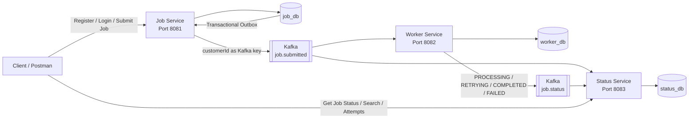

# Distributed Job Processing Platform

A distributed, asynchronous job-processing platform built using Spring Boot, Apache Kafka, PostgreSQL, JWT authentication, and Docker Compose.

The system allows multiple customers to submit long-running jobs such as report generation and data export. Jobs are processed asynchronously by workers, retried on failure, and tracked through a separate status service.

The platform is designed around microservice isolation, Kafka-based communication, database-per-service architecture, customer-level ordering, idempotent event consumption, and transactional outbox publishing.

---

# Architecture Overview



## High-Level Flow

```text
Client
  |
  | POST /api/v1/jobs
  v
Job Service
  |
  +--> Save Job
  |
  +--> Save Outbox Event
  |
  v
job_db
  |
  v
Outbox Publisher
  |
  v
Kafka: job.submitted
  |
  +-----------------------+
  |                       |
  v                       v
Worker Service       Status Service
  |                       |
  |                       +--> Creates SUBMITTED read model
  |
  +--> Process Job
  |
  +--> Retry if required
  |
  v
worker_db
  |
  v
Kafka: job.status
  |
  v
Status Service
  |
  +--> Current Job Status
  +--> Processing Attempt History
  +--> Processed Event IDs
  |
  v
status_db
```

---

# Microservices

The platform contains three independently deployable Spring Boot microservices.

## 1. Job Service

**Port:** `8081`

The Job Service is the entry point for customers.

### Responsibilities

- Customer registration
- Customer login
- JWT generation
- Password hashing
- Authentication and authorization
- Accept job-submission requests
- Extract trusted `customerId` from JWT
- Store submitted jobs
- Create transactional outbox events
- Publish `job.submitted` Kafka events
- Use `customerId` as Kafka message key

### Main Components

```text
job-service/
└── src/main/java/com/example/jobservice/
    ├── config/
    │   ├── JwtConfig.java
    │   ├── SecurityConfig.java
    │   ├── PasswordConfig.java
    │   └── KafkaTopicConfig.java
    ├── controller/
    │   ├── AuthController.java
    │   └── JobController.java
    ├── dto/
    │   ├── RegisterRequest.java
    │   ├── LoginRequest.java
    │   ├── AuthResponse.java
    │   ├── CreateJobRequest.java
    │   ├── JobResponse.java
    │   └── JobSubmittedEvent.java
    ├── entity/
    │   ├── User.java
    │   ├── Job.java
    │   └── OutboxEvent.java
    ├── repository/
    │   ├── UserRepository.java
    │   ├── JobRepository.java
    │   └── OutboxEventRepository.java
    └── service/
        ├── AuthService.java
        ├── JwtService.java
        ├── JobService.java
        └── OutboxPublisher.java
```

---

## 2. Worker Service

**Port:** `8082`

The Worker Service executes long-running jobs.

### Responsibilities

- Consume `job.submitted`
- Prevent duplicate terminal execution
- Persist worker execution state
- Select the correct processor by job type
- Execute long-running jobs
- Retry failed jobs
- Track retry count
- Publish execution-status events
- Preserve same-customer ordering within Kafka partitions

### Supported Job Types

```text
REPORT_GENERATION
DATA_EXPORT
```

### Main Components

```text
worker-service/
└── src/main/java/com/example/workerservice/
    ├── consumer/
    │   └── JobConsumer.java
    ├── dto/
    │   ├── JobSubmittedEvent.java
    │   └── JobStatusEvent.java
    ├── entity/
    │   └── WorkerJob.java
    ├── repository/
    │   └── WorkerJobRepository.java
    ├── processor/
    │   ├── JobProcessor.java
    │   ├── JobProcessorFactory.java
    │   ├── ReportGenerationProcessor.java
    │   ├── DataExportProcessor.java
    │   └── FailureSimulator.java
    └── service/
        └── StatusPublisher.java
```

---

## 3. Status Service

**Port:** `8083`

The Status Service maintains a customer-facing read model of job execution.

### Responsibilities

- Consume initial `job.submitted` events
- Consume worker-generated `job.status` events
- Maintain current job status
- Maintain attempt-by-attempt execution history
- Track processed event IDs
- Ignore duplicate Kafka events
- Provide search, filter, pagination, and sorting
- Enforce customer-level authorization
- Prevent customers from reading other customers' jobs

### Main Components

```text
status-service/
└── src/main/java/com/example/statusservice/
    ├── config/
    │   ├── JwtConfig.java
    │   └── SecurityConfig.java
    ├── consumer/
    │   └── StatusConsumer.java
    ├── controller/
    │   └── JobStatusController.java
    ├── dto/
    │   ├── JobSubmittedEvent.java
    │   ├── JobStatusEvent.java
    │   ├── JobStatusResponse.java
    │   └── ProcessingAttemptResponse.java
    ├── entity/
    │   ├── JobStatusView.java
    │   ├── ProcessingAttempt.java
    │   └── ProcessedEvent.java
    ├── repository/
    │   ├── JobStatusRepository.java
    │   ├── ProcessingAttemptRepository.java
    │   └── ProcessedEventRepository.java
    └── service/
        └── JobStatusService.java
```

---

# Authentication

Authentication uses JWT bearer tokens.

Customers first register or log in through the Job Service.

The JWT contains the trusted customer identity.

Example claims:

```json
{
  "sub": "user-id",
  "customerId": "CUST-ABC12345",
  "email": "customer@example.com",
  "role": "CUSTOMER"
}
```

The client does not provide `customerId` while submitting a job.

Instead:

```text
JWT
 |
 v
customerId
 |
 v
Job.customerId
 |
 v
Kafka key
```

This prevents one customer from submitting jobs as another customer.

---

# API Documentation

## Register Customer

```http
POST /api/v1/auth/register
```

Base URL:

```text
http://localhost:8081
```

Request:

```json
{
  "name": "Customer A",
  "email": "a@example.com",
  "password": "Password123"
}
```

Example response:

```json
{
  "accessToken": "eyJ...",
  "tokenType": "Bearer",
  "expiresIn": 3600,
  "customerId": "CUST-ABC12345",
  "email": "a@example.com"
}
```

---

## Login

```http
POST /api/v1/auth/login
```

Request:

```json
{
  "email": "a@example.com",
  "password": "Password123"
}
```

Returns a JWT access token.

---

## Submit Job

```http
POST /api/v1/jobs
```

Base URL:

```text
http://localhost:8081
```

Header:

```text
Authorization: Bearer <JWT>
Content-Type: application/json
```

Request:

```json
{
  "type": "REPORT_GENERATION",
  "parameters": {
    "reportType": "MONTHLY"
  }
}
```

Example response:

```json
{
  "jobId": "uuid",
  "type": "REPORT_GENERATION",
  "customerId": "CUST-ABC12345",
  "status": "SUBMITTED",
  "attempts": 0
}
```

HTTP status:

```text
202 Accepted
```

---

## Get Current Job Status

```http
GET /api/v1/jobs/{jobId}
```

Base URL:

```text
http://localhost:8083
```

Header:

```text
Authorization: Bearer <JWT>
```

Example response:

```json
{
  "jobId": "uuid",
  "jobType": "REPORT_GENERATION",
  "customerId": "CUST-ABC12345",
  "status": "COMPLETED",
  "attempts": 3,
  "createdAt": "2026-10-14T10:00:00",
  "processingStartedAt": "2026-10-14T10:00:02",
  "completedAt": "2026-10-14T10:00:15",
  "failedAt": null,
  "errorMessage": null
}
```

---

## Get Processing Attempts

```http
GET /api/v1/jobs/{jobId}/attempts
```

Example response:

```json
[
  {
    "attempt": 1,
    "status": "FAILED",
    "startedAt": "2026-10-14T10:00:02",
    "finishedAt": "2026-10-14T10:00:03",
    "errorMessage": "Simulated failure for attempt 1"
  },
  {
    "attempt": 2,
    "status": "FAILED",
    "startedAt": "2026-10-14T10:00:05",
    "finishedAt": "2026-10-14T10:00:06",
    "errorMessage": "Simulated failure for attempt 2"
  },
  {
    "attempt": 3,
    "status": "COMPLETED",
    "startedAt": "2026-10-14T10:00:10",
    "finishedAt": "2026-10-14T10:00:15",
    "errorMessage": null
  }
]
```

---

## Search Jobs

```http
GET /api/v1/jobs
```

Supported query parameters:

```text
type
status
from
to
page
size
sortBy
direction
```

Examples:

```http
GET /api/v1/jobs?status=COMPLETED
```

```http
GET /api/v1/jobs?type=REPORT_GENERATION
```

```http
GET /api/v1/jobs?page=0&size=10
```

```http
GET /api/v1/jobs?sortBy=createdAt&direction=DESC
```

```http
GET /api/v1/jobs?status=COMPLETED&type=REPORT_GENERATION&page=0&size=10
```

The customer ID is always taken from the JWT.

Clients cannot search another customer's jobs by passing another `customerId`.

---

# Database Design

Each microservice owns a separate PostgreSQL database.

```text
job-service    -> job_db
worker-service -> worker_db
status-service -> status_db
```

No service directly queries another service's database.

---

## Job Database

Database:

```text
job_db
```

### `users`

```text
id
customer_id
name
email
password
created_at
```

Purpose:

- Customer authentication
- Customer identity

### `jobs`

```text
id
customer_id
job_type
parameters
status
attempts
created_at
```

Purpose:

- Source record for submitted jobs

### `outbox_events`

```text
id
event_id
aggregate_id
event_type
kafka_key
payload
published
created_at
published_at
```

Purpose:

- Reliable Kafka publication using the transactional outbox pattern

---

## Worker Database

Database:

```text
worker_db
```

### `worker_jobs`

```text
job_id
submission_event_id
customer_id
job_type
status
attempts
error_message
processing_started_at
completed_at
failed_at
```

Purpose:

- Worker execution state
- Retry tracking
- Duplicate execution protection

---

## Status Database

Database:

```text
status_db
```

### `job_status`

```text
job_id
customer_id
job_type
parameters
status
attempts
created_at
processing_started_at
completed_at
failed_at
error_message
```

Purpose:

- Current customer-facing job status

### `processing_attempts`

```text
id
job_id
attempt_number
status
started_at
finished_at
error_message
```

Unique constraint:

```text
(job_id, attempt_number)
```

Purpose:

- Full attempt-by-attempt history

### `processed_events`

```text
event_id
processed_at
```

Purpose:

- Kafka event idempotency

---

# Kafka Topic Design

The system uses two main Kafka topics.

## `job.submitted`

Partitions:

```text
3
```

Producer:

```text
job-service
```

Consumers:

```text
worker-service
status-service
```

Kafka key:

```text
customerId
```

Example event:

```json
{
  "eventId": "uuid",
  "jobId": "uuid",
  "customerId": "CUST-ABC12345",
  "jobType": "REPORT_GENERATION",
  "parameters": {
    "reportType": "MONTHLY"
  },
  "createdAt": "2026-10-14T10:00:00"
}
```

---

## `job.status`

Partitions:

```text
3
```

Producer:

```text
worker-service
```

Consumer:

```text
status-service
```

Kafka key:

```text
customerId
```

Example:

```json
{
  "eventId": "uuid",
  "jobId": "uuid",
  "customerId": "CUST-ABC12345",
  "jobType": "REPORT_GENERATION",
  "status": "PROCESSING",
  "attempt": 1,
  "errorMessage": null,
  "timestamp": "2026-10-14T10:00:02"
}
```

Possible statuses:

```text
PROCESSING
RETRYING
COMPLETED
FAILED
```

---

# Kafka Partitioning Strategy

The Kafka message key is:

```text
customerId
```

Kafka hashes the key and routes all records for that customer to the same partition.

Example:

```text
Customer A:
A1
A2
A3

Customer B:
B1
B2
```

Possible Kafka distribution:

```text
Partition 0:
A1
A2
A3

Partition 2:
B1
B2
```

This provides:

```text
A1 -> A2 -> A3
```

ordering for Customer A while allowing Customer B's jobs to be processed independently.

This strategy satisfies the requirement that jobs belonging to the same customer preserve ordering while different customers can execute concurrently.

Worker Kafka listener concurrency is configured to allow multiple partitions to be processed in parallel.

---

# Retry Approach

The worker retries failed processing up to three attempts.

```text
MAX_ATTEMPTS = 3
```

Example:

```text
Attempt 1
   |
   X failure
   |
   v
RETRYING

Attempt 2
   |
   X failure
   |
   v
RETRYING

Attempt 3
   |
   v
COMPLETED
```

Current retry delay is a simple increasing blocking delay.

Conceptually:

```text
attempt 1 failure -> wait 2 seconds
attempt 2 failure -> wait 4 seconds
```

Blocking the Kafka partition during retry is intentional in this POC because it prevents a later job for the same customer from overtaking the failed job.

---

# Failure Simulation

For demonstration and testing, failures can be simulated through job parameters.

## Fail first two attempts

```json
{
  "type": "REPORT_GENERATION",
  "parameters": {
    "failUntilAttempt": 2
  }
}
```

Expected result:

```text
Attempt 1 -> FAILED
Attempt 2 -> FAILED
Attempt 3 -> COMPLETED
```

---

## Permanent Failure

```json
{
  "type": "DATA_EXPORT",
  "parameters": {
    "forceFailure": true
  }
}
```

Expected result:

```text
Attempt 1 -> FAILED
Attempt 2 -> FAILED
Attempt 3 -> FAILED

Final job status -> FAILED
```

---

# Failure-Handling Approach

## Job Database Failure

Job creation and outbox creation happen in one database transaction.

If the database transaction fails:

```text
Job not saved
Outbox not saved
```

No Kafka event is published.

---

## Kafka Failure During Submission

The Job Service uses the transactional outbox pattern.

Instead of performing:

```text
DB save
then
Kafka send
```

inside the same request flow, it performs:

```text
single DB transaction
    |
    +--> save Job
    +--> save OutboxEvent
```

A background outbox publisher later sends unpublished events to Kafka.

If Kafka is temporarily unavailable:

```text
published = false
```

remains in the database.

The publisher retries later.

---

## Worker Processing Failure

Worker exceptions trigger retry logic.

The worker:

```text
increments attempts
stores error information
publishes RETRYING
waits
tries again
```

After the maximum attempt count:

```text
status = FAILED
```

is emitted.

---

## Status Database Failure

If status processing fails before the Kafka event has been successfully persisted, the Kafka consumer can receive the event again.

Idempotency protects successfully processed events from duplicate application.

---

## Worker Crash

Kafka uses consumer-group offsets.

If the worker crashes before successfully completing consumption, the partition can be reassigned and the event can be processed again after restart/rebalance.

Worker-side persisted state and duplicate checks reduce accidental repeated terminal execution.

---

# Idempotency Approach

Kafka provides at-least-once style delivery behavior in normal consumer scenarios.

Therefore the application must assume duplicate delivery is possible.

## Status Service

Every Kafka event has a unique:

```text
eventId
```

After processing an event, Status Service stores it in:

```text
processed_events
```

Before handling another event:

```text
if eventId already exists
    ignore event
```

This prevents duplicate state transitions.

---

## Worker Service

Worker Service stores:

```text
submissionEventId
jobId
status
```

If a duplicate submission is received and the job is already terminal:

```text
COMPLETED
```

or:

```text
FAILED
```

the duplicate is ignored.

---

# Customer Isolation

The authenticated customer's `customerId` comes from the JWT.

For example:

```text
JWT customerId = CUST-A
```

If Customer A requests Customer B's job:

```text
requested job.customerId = CUST-B
```

Status Service returns:

```text
404 Job not found
```

rather than revealing that another customer's job exists.

Search requests are automatically restricted by the authenticated customer ID.

---

# Logging

Logs include contextual identifiers through MDC where applicable.

Typical fields:

```text
jobId
eventId
customerId
attempt
```

Example:

```text
INFO [jobId=abc eventId=xyz customerId=CUST-A attempt=2]
Job attempt started
```

These fields make it easier to trace one job across asynchronous service boundaries.

---

# Running the Application

## Requirements

You need:

```text
Docker
Docker Compose
```

For local non-Docker development:

```text
Java 17
Maven
PostgreSQL
Kafka
```

---

# Docker Compose

Project structure:

```text
distributed-job-platform/
│
├── compose.yaml
├── .env
├── job-service/
├── worker-service/
└── status-service/
```

Create `.env`:

```properties
POSTGRES_USER=postgres
POSTGRES_PASSWORD=postgres

JWT_SECRET=01234567890123456789012345678901
JWT_EXPIRATION_SECONDS=3600
```

---

## Build

```bash
docker compose build
```

---

## Start

```bash
docker compose up -d
```

Or build and start together:

```bash
docker compose up -d --build
```

---

## Check Containers

```bash
docker compose ps
```

Expected services:

```text
job-platform-kafka
job-db
worker-db
status-db
job-service
worker-service
status-service
```

---

## Application Ports

```text
Job Service       http://localhost:8081
Worker Service    http://localhost:8082
Status Service    http://localhost:8083
Kafka             localhost:9092
```

PostgreSQL host ports:

```text
job_db      localhost:5433
worker_db   localhost:5434
status_db   localhost:5435
```

---

## Health Checks

```text
http://localhost:8081/actuator/health
http://localhost:8082/actuator/health
http://localhost:8083/actuator/health
```

Expected:

```json
{
  "status": "UP"
}
```

---

# View Logs

Job Service:

```bash
docker compose logs -f job-service
```

Worker:

```bash
docker compose logs -f worker-service
```

Status Service:

```bash
docker compose logs -f status-service
```

All application services:

```bash
docker compose logs -f job-service worker-service status-service
```

---

# Inspect Kafka Topics

```bash
docker compose exec kafka \
/opt/kafka/bin/kafka-topics.sh \
--bootstrap-server kafka:19092 \
--list
```

Expected:

```text
job.submitted
job.status
```

Describe:

```bash
docker compose exec kafka \
/opt/kafka/bin/kafka-topics.sh \
--bootstrap-server kafka:19092 \
--describe \
--topic job.submitted
```

Expected partition count:

```text
3
```

---

# Inspect Databases

## Job Database

```bash
docker compose exec job-db psql -U postgres -d job_db
```

Useful queries:

```sql
SELECT * FROM users;

SELECT * FROM jobs;

SELECT * FROM outbox_events;
```

---

## Worker Database

```bash
docker compose exec worker-db psql -U postgres -d worker_db
```

```sql
SELECT * FROM worker_jobs;
```

---

## Status Database

```bash
docker compose exec status-db psql -U postgres -d status_db
```

```sql
SELECT * FROM job_status;

SELECT * FROM processing_attempts;

SELECT * FROM processed_events;
```

---

# Stop the Application

Preserve volumes:

```bash
docker compose down
```

Completely reset including Kafka and PostgreSQL data:

```bash
docker compose down -v
```

Then restart:

```bash
docker compose up -d --build
```

---

# Example End-to-End Test

## 1. Register

```http
POST http://localhost:8081/api/v1/auth/register
```

```json
{
  "name": "Customer A",
  "email": "a@example.com",
  "password": "Password123"
}
```

Copy the returned token.

---

## 2. Submit Job

```http
POST http://localhost:8081/api/v1/jobs
```

Header:

```text
Authorization: Bearer <TOKEN>
```

Body:

```json
{
  "type": "REPORT_GENERATION",
  "parameters": {
    "reportType": "MONTHLY",
    "failUntilAttempt": 2
  }
}
```

Save the returned `jobId`.

---

## 3. Check Job

```http
GET http://localhost:8083/api/v1/jobs/{jobId}
```

Expected final result:

```text
status = COMPLETED
attempts = 3
```

---

## 4. Check Attempt History

```http
GET http://localhost:8083/api/v1/jobs/{jobId}/attempts
```

Expected:

```text
Attempt 1 FAILED
Attempt 2 FAILED
Attempt 3 COMPLETED
```
---

# Design Summary

The architecture follows these core principles:

```text
Database per service
Asynchronous communication
Kafka-based event flow
Customer-level ordering
JWT-based customer isolation
At-least-once-aware processing
Idempotent consumers
Transactional outbox
Retry handling
Independent microservice deployment
Separate operational and read-model state
```

The simplest mental model is:

```text
Job Service
accepts the work

Worker Service
does the work

Status Service
explains what happened to the work
```

Kafka connects the services asynchronously:

```text
Job Service
     |
     | job.submitted
     v
Worker Service
     |
     | job.status
     v
Status Service
```

The resulting system demonstrates asynchronous job processing, customer-level ordering, retries, failure handling, event-driven communication, idempotency, microservice isolation, and containerized deployment.
